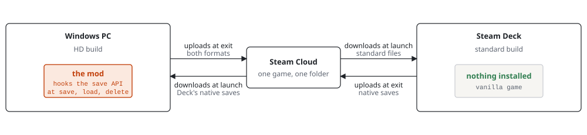

# Dragon Ball Z Kakarot Save Syncer

A mod for DRAGON BALL Z: KAKAROT on Steam that automatically keeps your saves in-sync between
the standard and HD versions of the game, even across devices.

Wished you could play the HD version on your PC and the standard version on your Steam Deck or
another device? Now you can, and no manual "Transfer Save Data" button needed. Set it and
forget it.

## Quick install

1. Back up your saves by copying this folder somewhere safe. It holds the saves of both the
   standard and HD versions:
   `...\Steam\userdata\<your Steam id>\851850\remote`
2. Go to the [Releases page](https://github.com/deusgladiorum/dbz-kakarot-save-syncer/releases)
   and download the latest `dbz-kakarot-save-syncer-<version>.zip`.
3. Extract all of its contents into the HD version's folder:
   `...\steamapps\common\DRAGON BALL Z KAKAROT\dlc\Remaster\AT\Binaries\Win64\`

That's it. Play either version as normal. Steam Cloud must be enabled for the game, which it is
by default. A Steam Deck or second PC that plays the standard version needs nothing installed.

To uninstall, delete `dbz-kakarot-save-syncer.asi` and `xinput1_3.dll` from that folder. Your
saves are never touched by uninstalling.

If a save ever refuses to load or save after a Steam update, fully exit and restart Steam.

## How it works

The game stores both versions' saves in the same Steam Cloud folder, and the HD version already
knows how to convert a standard save into its own format. The mod does that conversion
automatically, in both directions, every time you save.



It is loaded into the game by Ultimate ASI Loader and hooks the game's Steam Remote Storage
calls. When the game writes a save slot, the mod converts it to the other version's format and
writes it, and its save-list entry, through the same Remote Storage session, so Steam's index
and Steam Cloud see the result. At startup it compares each slot's save time in the two
versions and brings the older side up to date. It never deletes a save.

## Developer details

The design is in [`docs/design.html`](docs/design.html); the save mechanism reference (file
format, encryption, how the game saves, loads and transfers) is in
[`docs/save-mechanism.html`](docs/save-mechanism.html).

### Build

Requirements: Visual Studio 2026 (version 18) with the Desktop development with C++ workload
(toolset v145, a Windows 10 SDK or later). Only x64 is supported.

```
"C:\Program Files\Microsoft Visual Studio\18\Community\MSBuild\Current\Bin\amd64\MSBuild.exe" dbz-kakarot-save-syncer.slnx /p:Configuration=Release /p:Platform=x64
```

Outputs go to `x64\Release\` (`x64\Debug\` for Debug): `dbz-kakarot-save-syncer.asi`,
`kakarot_cli.exe` and `plugin_test.exe`.

### Test

Both test programs need a copy of the game's standard-build exe (the AES key is read from it)
and a folder of save backups. Neither writes to the game folder or the backups folder.

#### Plugin tests

```
x64\Release\plugin_test.exe --exe STANDARD_EXE --fixtures BACKUPS_DIR [--scratch DIR] [--cli KAKAROT_CLI]
```

- `--exe`: the standard build's `AT\Binaries\Win64\AT-Win64-Shipping.exe` (required; falls back to `KAKAROT_EXE`).
- `--fixtures`: the folder holding the backup sets the cases copy their saves from (required;
  falls back to `KAKAROT_FIXTURES`).
- `--scratch`: where logs and outputs go (default `out\plugin_test\`).
- `--cli`: the `kakarot_cli.exe` that produces the expected bytes (default: next to the test).

It prints one `PASS`/`FAIL` line per case and exits non-zero if any case fails.
`plugin/README.md` describes what the cases cover.

#### Oracle test

The oracle test checks that `kakarot_cli.exe` produces byte-identical output to the Python
tools in `tools/`. Set up the Python environment once:

```
python -m venv .venv
.venv\Scripts\python.exe -m pip install cryptography
```

Then run:

```
.venv\Scripts\python.exe tools\oracle_test.py --cli x64\Release\kakarot_cli.exe --exe STANDARD_EXE --hd-exe HD_EXE --saves BACKUPS_DIR
```

- `--cli`: the built `kakarot_cli.exe` under test.
- `--exe`: the standard build's `AT-Win64-Shipping.exe` (key source).
- `--hd-exe`: the HD build's `dlc\Remaster\AT\Binaries\Win64\AT-Win64-Shipping.exe`; optional,
  adds the key-scan case.
- `--saves`: the folder holding the backup sets (read only).
- `--out`: where outputs go (default `out\oracle\`).

The backup sets each test expects are named at the top of `tools/oracle_test.py` and
`plugin_test/main.cpp`.

### Package

```
powershell -ExecutionPolicy Bypass -File tools\package.ps1 [-TestExe STANDARD_EXE] [-TestFixtures BACKUPS_DIR]
```

The script rebuilds Release x64, checks that the `.asi` does not depend on the C++ runtime DLLs,
runs `plugin_test.exe` (and stops if it fails; skipped with a warning unless `KAKAROT_EXE` and
`KAKAROT_FIXTURES` or the two parameters are set), and writes `dist\dbz-kakarot-save-syncer-<version>.zip`
with the `.asi`, `xinput1_3.dll`, `INSTALL.txt` and the licences. The version is read from
`VERSION`. `INSTALL.txt` is generated from `tools/INSTALL.txt` with the version and the
loader's version and SHA-256 filled in.

### Repository layout

| Folder | Contents |
|---|---|
| `core/` | Static library: AES-256, save-file parsing, build detection, the conversions, key lookup |
| `plugin/` | Static library: the hooks, reconcile pass, manifest, log and Remote Storage access |
| `cli/` | `kakarot_cli.exe`, command-line front end to `core/` |
| `plugin_test/` | `plugin_test.exe`, the plugin tests against a fake Remote Storage |
| `tools/` | Python save tools (the oracle), `oracle_test.py`, `package.ps1`, `INSTALL.txt` template |
| `docs/` | The design and the save mechanism reference |
| `third_party/` | Ultimate ASI Loader, redistributed unmodified (see its README) |

The `.asi` project itself (`dbz-kakarot-save-syncer.vcxproj`, `dllmain.cpp`) is at the root.
`x64/`, `obj/`, `out/` and `dist/` are build, test and packaging output and are not tracked.

## Licence

MIT, see `LICENSE.txt`. Ultimate ASI Loader is MIT-licensed by its own authors.
